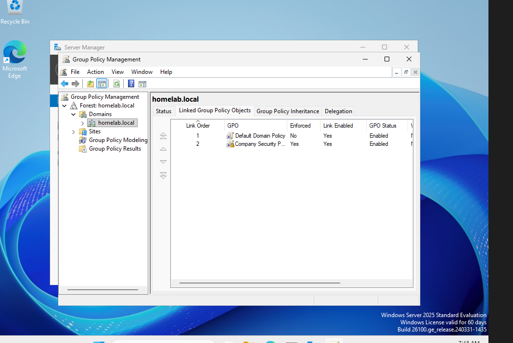
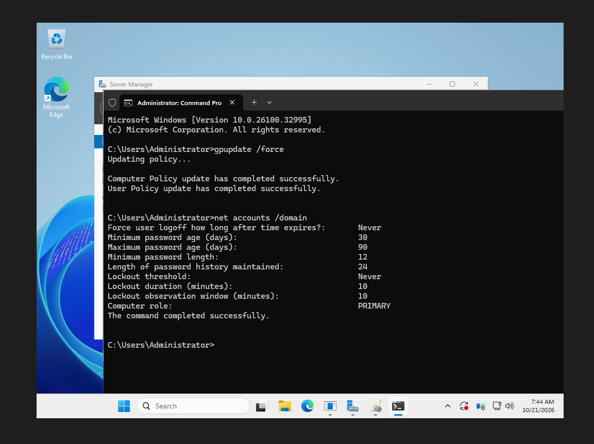
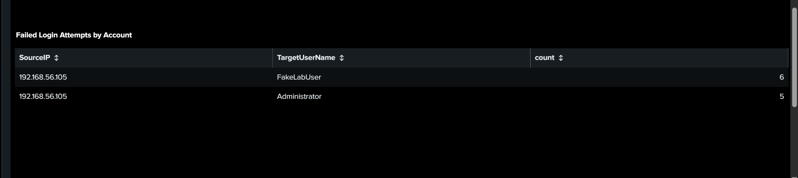

# Active Directory & Splunk SIEM Home Lab

A virtualized cybersecurity lab built to practice Windows domain administration, centralized log collection, and security investigations using Splunk Enterprise.

## Overview

This project uses four virtual machines in an isolated VirtualBox network to monitor Windows authentication activity, analyze endpoint events, and investigate controlled attack simulations.

## Lab Setup

**DC01 — Domain Controller**
- Windows Server 2025
- Active Directory Domain Services
- DNS and Group Policy

**PC01 — Windows Client**
- Windows 11
- Joined to the Active Directory domain
- Splunk Universal Forwarder

**Ubuntu — SIEM Server**
- Ubuntu Server 24.04.4 LTS
- Splunk Enterprise
- Centralized Windows log collection

**Kali Linux — Testing Machine**
- Used to generate controlled security-testing activity
- Used for failed-login and Kerberoasting simulations

**Network:** VirtualBox host-only network (`192.168.56.0/24`)

## Technologies

- **SIEM:** Splunk Enterprise, Splunk Universal Forwarder, SPL
- **Windows Security:** Active Directory, Group Policy, DNS, Windows Security Event Logs
- **Endpoint Monitoring:** Sysmon
- **Security Testing:** Kali Linux, failed-login testing, Kerberos service-ticket investigation
- **Virtualization:** Oracle VirtualBox

## Active Directory & Group Policy

**Domain:** `homelab.local`, hosted on DC01 with AD DS and DNS.

### Organizational Units

| OU | Contents |
|---|---|
| IT | User accounts `Thomas Long` and `Sarah Smith`; `IT_Admins` security group |
| Workstations | Workstation objects; contains the nested `Sales` OU (user `John Davis`) |
| Servers | Server objects |

### Password Policy GPO

Created a GPO named **Company Security Policy**, linked it at the domain level (`homelab.local`), and set it to **Enforced**. Domain password policy only takes effect from GPOs linked at the domain level, not at an OU.

| Setting | Value |
|---|---|
| Minimum password length | 12 characters |
| Password complexity | Enabled |
| Maximum password age | 90 days |
| Minimum password age | 30 days |

**Verification:** Ran `gpupdate /force` and `net accounts /domain` on DC01. The output confirmed the policy was applied: 12-character minimum length, 90-day maximum age, and 30-day minimum age. Password history (24) is inherited from the Default Domain Policy.





## Security Investigations

### Failed Login Analysis

- **MITRE ATT&CK:** T1110 — Brute Force (controlled failed-login simulation).
- Investigated Windows Security Event ID `4625`.
- Extracted usernames and source IP addresses from raw XML event data using SPL `rex`.
- Aggregated failed-login events by account and source IP using `stats`.
- Applied a threshold of five or more failures using `where`.
- Recorded test results included six failures for `FakeLabUser` and five for `Administrator` from the Kali test IP.
  
```spl
index=* host="WIN-THB17VDR2SD" "4625"
| rex field=_raw "Data Name='TargetUserName'>(?<TargetUserName>[^<]+)"
| rex field=_raw "Data Name='IpAddress'>(?<SourceIP>[^<]+)"
| stats count by SourceIP TargetUserName
| sort -count
| where count >= 5
```

**Findings:** The investigation identified 6 failed login attempts for `FakeLabUser` and 5 for `Administrator`, originating from the Kali Linux test IP (`192.168.56.105`).

**Response:** Investigate the source IP and targeted accounts, review surrounding authentication events, and consider account lockout policies if the activity is unauthorized.

### Kerberos Service-Ticket Investigation

- **MITRE ATT&CK:** T1558.003 — Kerberoasting (controlled lab simulation).
- Investigated Windows Security Event ID `4769`.
- Conducted a controlled Kerberoasting simulation involving the `SQLService` account.
- Extracted the source IP address from raw event data.
- Identified three matching service-ticket events associated with Kali Linux.
- Investigated the results in Splunk Search & Reporting.

```spl
index=* host="WIN-THB17VDR2SD" "4769" "SQLService"
| rex field=_raw "Data Name='IpAddress'>(?<SourceIP>[^<]+)"
| rex field=_raw "Data Name='TicketEncryptionType'>(?<EncryptionType>[^<]+)"
| stats count values(EncryptionType) as EncryptionType by SourceIP
```

**Findings:** The controlled Kerberoasting simulation generated Event ID `4769` activity associated with the `SQLService` account. Splunk identified 3 matching events from the Kali test IP (`192.168.56.105`).

**Response:** Review the requesting computer, service account, ticket encryption type, and surrounding authentication activity to determine whether the requests are suspicious.

### Sysmon Monitoring

- Collected Sysmon Operational event data.
- Extracted event IDs from XML-formatted logs.
- Aggregated event counts using SPL.
- Visualized endpoint activity in a custom dashboard.

## Splunk Dashboard

Created a four-panel dashboard named **Security Monitoring Dashboard**.

- Failed Login Attempts Over Time
- Kerberoasting Activity by Source IP
- Sysmon Events by Event ID
- Failed Login Attempts by Account

## Saved Searches

Created and enabled two reusable Splunk reports:

- `Failed Login Investigation by Source IP and Account`
- `Kerberoasting - SQLService Ticket Activity`

## Skills Demonstrated

- Active Directory and Windows Server administration
- Centralized log collection and SIEM configuration
- SPL query development and XML field extraction
- Windows authentication event analysis
- Kerberos service-ticket investigation
- Sysmon endpoint monitoring
- Security dashboard development
- Virtual machine networking and troubleshooting

## Future Improvements

- Add an account lockout policy to the GPO and detect resulting lockouts (Event ID `4740`) in Splunk.
- Expand monitoring to account creation and privileged-group changes.
- Implement automated alerting if using a Splunk license that supports it.
- Refine dashboard panels to make investigation results easier to interpret.

## Disclaimer

All security testing was performed in an isolated, self-managed lab for educational purposes. Results represent controlled test activity, not a real-world incident.

## Screenshots

### Failed Login Attempts Over Time


### Kerberoasting Activity by Source IP


### Sysmon Events by Event ID


### Failed Login Attempts by Account



## Project Files

- [Splunk investigation queries](queries/README.md)
- [Failed-login SPL search](queries/failed-login-investigation.spl)
- [Kerberos investigation SPL search](queries/kerberoasting-investigation.spl)
- [Lab screenshots](screenshots/)
